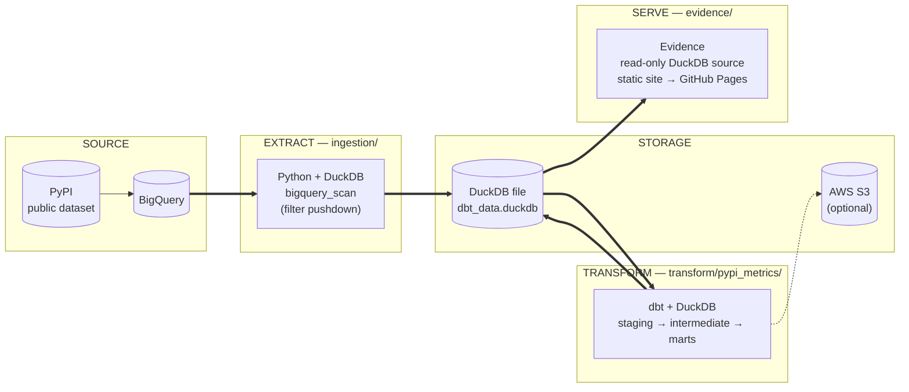
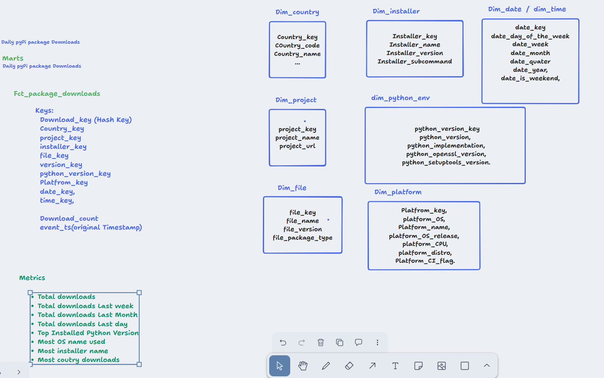

# Pypi Package Stats : get insights of your python project 🐍

An end-to-end data engineering project built with **Python**, **DuckDB**, **dbt**, and **Evidence** — ingesting raw data, transforming it into an analytics-ready star schema, and serving it through an interactive dashboard. Everything runs **locally** on DuckDB (no cloud warehouse), and the dashboard is published as a static site on **GitHub Pages**.

> Live dashboard: https://anass-nb.github.io/pypi-package-stats/

## High-level architecture



The project is a monorepo composed of three parts:

- **Ingestion** — under `ingestion/`: pulls raw download events from BigQuery's PyPI public dataset with Python + DuckDB (filter pushdown) and lands them in a local DuckDB file (and/or S3).
- **Transformation** — under `transform/pypi_metrics/`: dbt (`dbt-duckdb` adapter) models the raw events into a star schema (staging → intermediate → marts: dimensions + fact).
- **Visualization** — under `evidence/`: an Evidence project that reads the dbt DuckDB file **read-only** and builds a static dashboard deployed to GitHub Pages.

---

## Tech Stack

| Layer          | Tool                                   |
|----------------|-----------------------------------------|
| Language       | Python 3.12                             |
| Engine/warehouse | [DuckDB](https://duckdb.org/) (single local file, no MotherDuck) |
| Transformation | [dbt](https://www.getdbt.com/) (`dbt-duckdb` adapter) |
| Dashboard      | [Evidence](https://evidence.dev/) (`@evidence-dev/duckdb` source; DuckDB-WASM in the browser) |
| Hosting        | GitHub Pages (`gh-pages` branch)        |
| Dependency mgmt| [uv](https://github.com/astral-sh/uv)   |
| Task runner    | Make                                    |

---

## Project Structure

```
.
├── docs/                   # Diagrams, screenshots, data model image
├── ingestion/               # Python ingestion pipeline
├── transform/                # dbt project
│   └── pypi_metrics/
├── evidence/                 # Evidence dashboard (queries + pages)
├── Makefile                  # Pipeline shortcuts
├── .env.template             # Environment variable template
├── pyproject.toml
└── README.md
```

---

## Getting Started

### Prerequisites

- Python 3.12
- [uv](https://github.com/astral-sh/uv) for Python package management
- [Make](https://www.gnu.org/software/make/manual/make.html)
- Node.js 18+ (only needed for the dashboard)
- A GCP service-account JSON to scan the BigQuery public dataset (only needed to re-ingest)

### Setup

```bash
git clone https://github.com/Anass-NB/pypi-package-stats.git
cd pypi-package-stats
```

Copy the environment template and fill in your values:

```bash
cp .env.template .env
```

- `GOOGLE_APPLICATION_CREDENTIALS` — path to the GCP service-account JSON
- `START_DATE` / `END_DATE` — ingestion window
- `DBT_DUCKDB_PATH` / `DBT_DATABASE` / `DBT_SCHEMA` — where dbt writes the local DuckDB file
- `SKIP_BIGQUERY`, `DESTINATION`, `LOCAL_CSV_PATH` — ingestion behavior (local-first by default)

### Data Modeling



---

## Usage

**Ingestion**

```bash
make ingest
make ingest-test
```

**Transformation (dbt)**

```bash
make pypi-transform   # dbt seed + dbt run (star schema in the local DuckDB file)
```

**Dashboard (Evidence)**

```bash
make evidence-install   # first time only
make evidence-dev       # dev server → http://localhost:3000/pypi-package-stats/
make evidence-preview   # serve the production build locally → http://localhost:4173/pypi-package-stats/
make evidence-build     # rebuild sources from DuckDB + strict static build
make evidence-deploy    # build + push the site to the gh-pages branch
```

Typical loop after new data: `make pypi-transform` → `make evidence-dev` (or `evidence-deploy`).

---

## Roadmap

- [x] Local ingestion pipeline (Python + DuckDB)
- [x] dbt transformation layer (staging → intermediate → marts star schema)
- [x] Dashboard for visualizing results (Evidence, local DuckDB source)
- [x] Dashboard deployed to GitHub Pages
- [ ] CI/CD for automated dbt runs and tests
- [ ] Orchestration : Schedule the data pipeline to be daily running
- [ ] Deploy data pipeline
- [ ] Write unit tests for ingestion and transformation layers

---

## Author

**Anass Nabil** — Data Engineer
[GitHub](https://github.com/Anass-NB) · [LinkedIn](https://linkedin.com/in/anassnabil) · [anaz.me](https://anaz.me)
